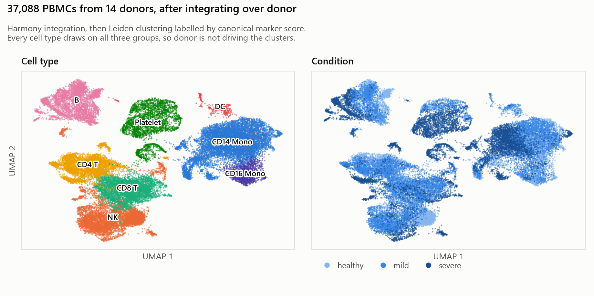
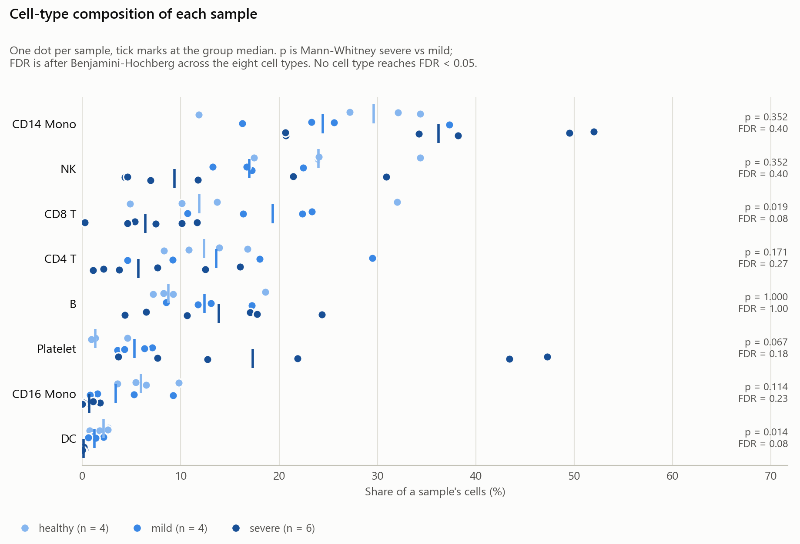
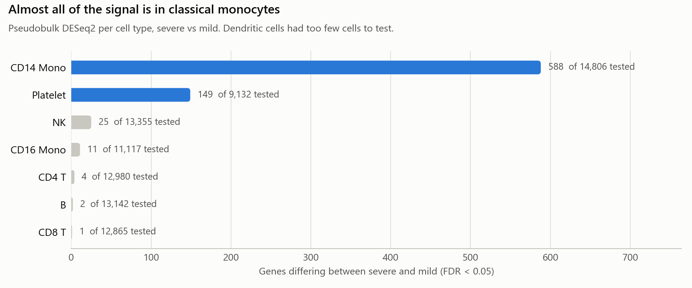
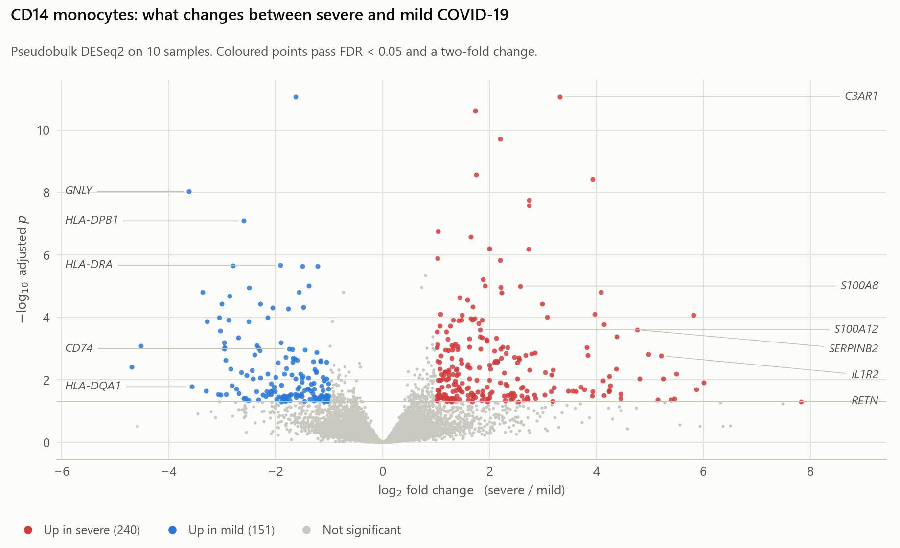
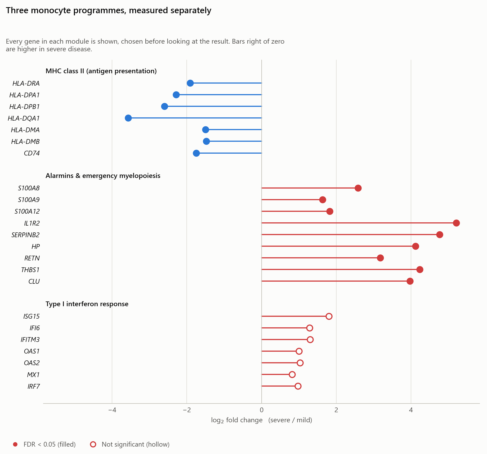
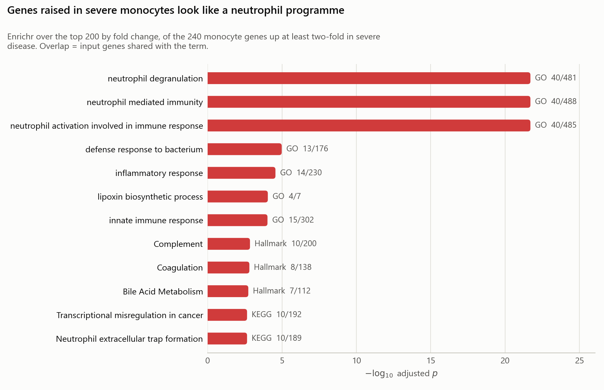

# Severe vs mild COVID-19 in blood immune cells

Single-cell RNA-seq reanalysis of [GSE149689](https://www.ncbi.nlm.nih.gov/geo/query/acc.cgi?acc=GSE149689):
37,088 PBMCs from 14 donors (4 healthy, 4 mild COVID-19, 6 severe COVID-19).
The question is which immune cells differ between patients who recover and
patients who become critically ill.

This is a reanalysis of public data, not my own experiment. The dataset is from
[Lee et al., *Science Immunology* 2020](https://doi.org/10.1126/sciimmunol.abd1554).
Every number below comes from a file in [`results/`](results/), rebuilt by
[`make_report.py`](make_report.py).

## Result

Classical monocytes carry nearly all the signal. Of the eight cell types tested,
CD14 monocytes gave 588 genes differing between severe and mild disease at
FDR < 0.05. The next highest was platelets at 149, and four cell types gave
fewer than five.

Inside those monocytes, two gene programmes move in opposite directions:

| Programme | In severe disease | Significant |
|---|---|---|
| MHC class II (*HLA-DRA*, *CD74*, …) | down, up to 12-fold | yes, all 7 genes |
| Alarmins (*S100A8/9/12*, *IL1R2*, *RETN*, …) | up, up to 37-fold | yes, all 9 genes |
| Type I interferon (*ISG15*, *MX1*, …) | up | no, all 7 genes FDR > 0.29 |

An antigen-presentation-low, alarmin-high monocyte is the state described in
severe COVID-19 and in bacterial sepsis, where it indicates a dysfunctional
innate response rather than a stronger one.

Two negative results are worth stating, since both are easy to leave out:

1. **No composition shift survives correction.** Dendritic cells and CD8 T cells
   are both lower in severe disease (p = 0.014 and 0.019), but with 4 mild
   against 6 severe donors neither clears FDR < 0.05.
2. **The type I interferon signature did not reproduce.** All seven interferon
   genes trend up and none reaches significance. This was the original study's
   headline, so its absence here matters. Possible reasons are in
   [Discussion](#discussion).

## Cells



Harmony integration over donor, then Leiden clustering gave 26 clusters,
labelled by canonical marker score into 8 populations:

| Cell type | Cells | Cell type | Cells |
|---|---:|---|---:|
| CD14 monocytes | 10,221 | B | 4,547 |
| NK | 6,956 | Platelet | 3,190 |
| CD8 T | 5,296 | CD16 monocytes | 1,559 |
| CD4 T | 4,843 | Dendritic cells | 476 |

## Composition



| Cell type | log₂FC severe/mild | p | FDR |
|---|---:|---:|---:|
| Dendritic cells | −3.42 | 0.014 | 0.076 |
| CD8 T | −1.60 | 0.019 | 0.076 |
| CD16 monocytes | −2.33 | 0.114 | 0.229 |
| Platelet | +1.71 | 0.067 | 0.178 |
| CD14 monocytes | +0.57 | 0.352 | 0.403 |

Dendritic-cell loss and T-cell lymphopenia are both well described in severe
COVID-19 and the directions match, but a Mann-Whitney test on 4 against 6 donors
cannot establish them.

## Expression



CD14 monocytes gave 588 genes at FDR < 0.05 (353 up in severe, 235 up in mild).
Platelets gave 149, almost all down, but platelet transcriptomes in PBMC
preparations are shaped by ambient RNA and handling, so I have not interpreted
them. Dendritic cells could not be tested: only one severe donor had enough
cells for a pseudobulk profile.



### Three programmes

The three gene modules below were chosen before looking at the results, and
every gene in each is shown.



**MHC class II falls.** All seven genes drop significantly: *HLA-DQA1* −3.57,
*HLA-DPB1* −2.60, *HLA-DPA1* −2.29, *HLA-DRA* −1.91, *CD74* −1.75,
*HLA-DMA* −1.50, *HLA-DMB* −1.48. Reduced monocyte HLA-DR is one of the most
reproducible markers of severe COVID-19 and of sepsis.

**Alarmins rise.** All nine go up: *IL1R2* +5.21, *SERPINB2* +4.77,
*THBS1* +4.23, *HP* +4.12, *CLU* +3.97, *RETN* +3.18, *S100A8* +2.58,
*S100A12* +1.82, *S100A9* +1.63. Together these describe the immature,
immunosuppressive monocyte reported in sepsis.

**Interferon does not separate the groups.** *ISG15* +1.80, *IFITM3* +1.30,
*IFI6* +1.29, with the smallest FDR 0.29 (*OAS1*). *TNF* and *IL1B* both trend
downward (−1.57 and −1.60), the opposite of a cytokine-storm picture, though
neither is significant either.

### Pathways



Neutrophil degranulation, neutrophil-mediated immunity and neutrophil activation
all return FDR ≈ 2 × 10⁻²², with 40 input genes in each term. Complement,
coagulation and neutrophil extracellular trap formation follow. Monocytes in
severely ill patients are running a granulocyte-like programme, consistent with
immature myeloid cells released from the marrow under emergency myelopoiesis.

## Discussion

The monocyte result is internally consistent and comes from a design that treats
the donor, not the cell, as the replicate. It matches a phenotype reported
independently in severe COVID-19 and in sepsis, which is reassuring because
nothing in the workflow was tuned to find it.

The interferon result is the more interesting one. Four explanations are
compatible with the data and I cannot separate them here:

- **Power.** Six severe against four mild donors, with severe pseudobulks built
  from a median of 299 cells against 895 for mild. Interferon genes also vary a
  lot between donors, which is where small n fails first.
- **Timing.** The interferon response peaks early and decays, so the contrast
  depends on when each donor was sampled after symptom onset. That is in the
  paper's Table S1 but is not modelled here.
- **Contrast.** This compares severe against *mild COVID-19*. The original
  analysis leans more on comparisons against healthy donors and influenza, where
  interferon differences are larger.
- **Annotation.** A coarse "CD14 Mono" label merges states that finer annotation
  would separate, diluting a signal confined to a subset.

So this cohort supports the monocyte dysfunction axis and is underpowered for
the interferon axis. That is not the same as the interferon finding being wrong.

## Limitations

- 4 mild against 6 severe donors for every comparison.
- Severe samples yielded fewer cells (8,508 across 6 donors, against 14,085
  across 4 mild). Some severe monocyte pseudobulks rest on as few as 141 cells.
- Cell types come from a marker-score pass over Leiden clusters, not reference
  mapping. Monocyte subsets and T-cell states are not resolved, and clusters
  were not manually reviewed against marker plots.
- Age, sex, days since onset and treatment are all in the source metadata and
  none is modelled.
- Mann-Whitney on proportions ignores their compositional nature. scCODA or Milo
  would be better.
- Enrichment covers only genes up in severe, and only the top 200 by fold change
  of the 240 that qualify.
- The healthy donors are loaded and integrated but every reported contrast is
  severe vs mild.

## Next steps

1. Add days-since-onset and age as covariates in the DESeq2 design.
2. Add severe-vs-healthy and mild-vs-healthy contrasts, plus the influenza
   donors as a different-virus comparison.
3. Replace marker-score annotation with reference mapping, then re-test within
   monocyte subsets.
4. Re-test composition with scCODA.
5. Score interferon activity per cell as a module score, which is better powered
   than seven separate gene tests.

## Reproduce

```bash
pip install -r requirements.txt

# 1. Download the GSE149689 matrix into data/GSE149689/ (see docs/workflow.md)
# 2. Run the analysis (30-60 min on a laptop)
python run_cohort.py --data data/GSE149689 --outdir results

# 3. Rebuild the tables and figures used above
python make_report.py
```

`make_report.py --figures` redraws the figures from the committed tables without
re-running anything. Setup details, the sample-to-condition mapping and Windows
notes are in [`docs/workflow.md`](docs/workflow.md).

## Method

| Step | Module | Approach |
|---|---|---|
| Load and label | `src/cohort.py` | donor and condition per barcode from the 10x suffix; severities from the paper's Table S1 |
| Integrate | `src/integration.py` | Harmony over `sample_id`, 2,000 HVGs |
| Cluster and annotate | `src/integration.py` | Leiden at resolution 1.0, then canonical marker scores |
| Composition | `src/differential_abundance.py` | per-donor proportions, Mann-Whitney, Benjamini-Hochberg |
| Expression | `src/differential_state.py` | pseudobulk per donor × cell type, then DESeq2 (pydeseq2) |
| Pathways | `src/enrichment.py`, `make_figures.py` | Enrichr over genes up at least two-fold in severe |

Pseudobulk rather than per-cell testing because cells from one donor are not
independent observations; aggregating makes the donor the unit of replication.
The cost is power: the monocyte comparison rests on 10 donors, not 10,221 cells.

## Files

| Path | Contents |
|---|---|
| `results/per_sample_qc.csv` | cells and median genes per donor, as loaded |
| `results/cell_type_proportions.csv` | per-donor cell-type counts and proportions |
| `results/abundance_severe_vs_mild.csv` | composition test with BH-corrected FDR |
| `results/cluster_to_celltype.csv`, `celltype_scores.csv` | cluster annotation and the marker scores behind it |
| `results/pseudobulk/deseq2_<cell type>_severe_vs_mild.csv` | full DESeq2 results, 7 cell types |
| `results/pseudobulk/pseudobulk_counts.csv`, `_metadata.csv` | the donor × cell-type matrix fed to DESeq2 |
| `results/enrichment/<cell type>/` | Enrichr output |
| `results/summary/` | derived tables behind this page |
| `results/summary/umap_coords.csv.gz` | UMAP coordinates per cell, so figure 1 redraws without the 527 MB object |
| `results/qc/` | UMAPs by cell type, condition, donor and cluster, plus QC violins |
| `figures/` | the six figures above |
| `src/`, `run_cohort.py` | analysis code |

The processed AnnData object (`cohort_processed.h5ad`, 527 MB) is not in the
repository, as it exceeds GitHub's file limit. `run_cohort.py` regenerates it.

## Licence

Code is MIT ([LICENSE](LICENSE)). The GSE149689 data belongs to its original
authors; cite [Lee et al. 2020](https://doi.org/10.1126/sciimmunol.abd1554) for
the data. Research and portfolio use only, not peer reviewed, not clinical
guidance.
